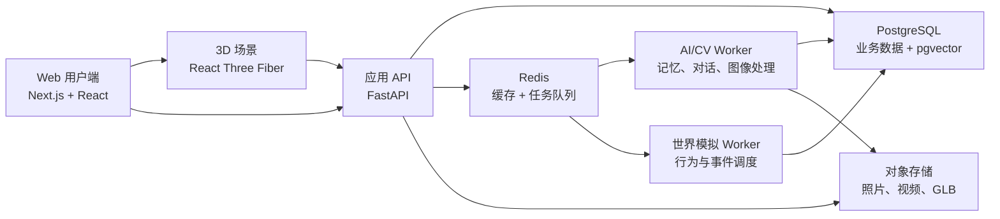

# 喵星（Miaoxing）

> 第一版：为想念的宠物留一间可保存、可探望的纪念房间。

源码仓库：[ZZX0109/CatPlanet](https://github.com/ZZX0109/CatPlanet)。`main` 分支自动执行类型检查、生产构建并发布 Docker 镜像；完整网站需要另行配置服务器，GitHub Pages 无法直接承载现有后端。[GitHub 与部署说明](./docs/GITHUB.md)。公开仓库不包含本机密钥、私人数据、Blender 大文件及尚未核实分发权限的用户母模；下文涉及这些素材的造型室功能需要在本地补齐文件。

本轮范围：**体验房间 → 创建纪念宠物 → 选择两种基础猫 → 轻触互动 → 记录照片与回忆 → 邮箱验证码登录保存 → 换设备恢复**。新增无需 AI 的规则生活日记，在再次探望时补记活动；聊天、社区和照片生成 3D 模型尚未实现；下方的长期愿景与技术资料是后续参考。

### 房间与建模接入进度

房间现支持导入造型室导出的外观 JSON，随宠物档案保存，并在登录后恢复定制猫。使用当前造型室参数校验器，兼容旧 v3 外观迁移。定制猫暂以站姿显示并支持轻触转身，走路与趴卧仍待建模侧交付并验收；基础猫原有动作保留。此流程不依赖造型室本机存储，换设备登录会读取账号中的外观快照。

### 猫咪建模云端工程入口

新增 [统一 CLI 与协议](./cat-modeling/README.md)、[机器可读任务契约](./cat-modeling/contracts/) 和 [Codex Skill](./.agents/skills/miaoxing-cat-model/SKILL.md)。现有造型室保留；外观设计、资产哈希/拓扑、groom、渲染器兼容和实际能力分别验证。旧 v3/v4 外观经原解析器迁移至 v5，旧资产 ID/哈希和历史存档保留。

云端支持契约、GLB 静态检查、授权元数据检查、独立任务和本地执行器交接。**未配置生产模型时，infer 明确返回不可用**；原创几何 fixture 只供公开回归，不能称为照片转三维、猫专用 AI 或真实母模验收。A 形态、B 毛色花纹、C 毛流/长度/密度的预测模块采用独立版本接口，当前没有权重、合法训练集或 GPU 服务。训练和 GPU 推理不运行在 Next.js 请求进程。

```sh
npm ci
npm run test:cat-modeling
npm run test:cat-modeling:browser
npm run typecheck
npm run build
```

浏览器测试需要 Playwright Chromium：可运行 `npx playwright install chromium`，或通过 `CHROMIUM_PATH` 指定现有浏览器。GitHub Actions 的公开测试不需要私有 Blender 文件、账号数据库或密钥。它们验证真实 GLB 解码和合成数据恢复，不能替代私有 Norwegian/Sphynx 的骨架、毛发、动作和四阶段视觉验收；缺少真实资产时这些项目仍为 blocked/unrun。

需要 Blender 的制作/渲染通过任务协议交给获准的本地执行器；预览计划不代表已生成图片。生产发布当前未实现，任何正式激活都必须先取得真实验收证据、授权和用户明确确认。不会自动覆盖当前模型、上传私人照片或修改生产数据库。[本轮工程与本地验收边界](./docs/CAT-MODELING-CLOUD-REFACTOR.md)。

- [模型接入协议与建模交付边界](./docs/MODEL-INTEGRATION.md)
- [六项开发目标核对与剩余工作](./docs/DEVELOPMENT-STATUS.md)
- 已增加本机草稿恢复（含照片、未完成回忆和外观）、账号隔离以及房间视角按钮。房间模型现使用独立版本存档与文件校验；后续待办：真实云部署与设备验收、记忆聊天。已增加[离线生活日记](./docs/PET-LIFE.md)，活动在再次打开日记时补记。当前按用户要求优先本地体验。

### 先运行第一版

[猫咪造型室](http://localhost:3000/studio/base) 默认显示**完整程序被毛**，支持 14 项捏脸、六项分区毛量／毛长、站姿与趴卧、本机保存和导出。毛发面板可切换“完整被毛”和“仅看原模型”。当前优化保留原有毛根，按整簇选择显示细节，并逐步向共享毛簇中心收束，减少孤立细针；不再用关闭整层毛的方式处理碎毛。[本轮改动与验证](./docs/CAT-PROCEDURAL-GROOM-REPAIR.md)。

已核对并恢复之前被误清理的 **342 簇原生耳毛**，沿用原毛色、UV 和骨骼绑定；构建规则也同步修复。全身毛感继续沿原有毛面、毛流与成束轮廓精修，恢复耳毛不代表完整短毛／长毛已经达到写实标准。

原毛面光学、短长包络和原生 Blender groom 对照保留为本地研究，未替换网页母模。原生数据的静态网页转换、短长编辑及源反射／透射计算已有验证；当前开发已按用户要求回到现有程序毛层上修复覆盖和碎毛。[研究记录与采用边界](./docs/CAT-NATIVE-GROOM-ITERATIONS.md)。

无毛使用你提供的斯芬克斯独立底模；短、长毛原型仍共用挪威森林猫网格。原素材预览不是两套已经完成的独立短毛、长毛资产，完整毛型差异还在制作。[三类区别、制作文件与下一步](./docs/CAT-COAT-TEMPLATES.md) · [完整操作说明](./docs/CAT-CREATOR.md)。

完整被毛包含贴伏短绒、长毛底绒与披毛、围脖、后腿饰毛和尾毛。外观 JSON 使用版本 5：旧 v3/v4 恢复完整被毛，保留原脸型、类型和全部毛量／毛长；v5 显式选择“仅看原模型”仍会保留。无毛猫继续使用独立斯芬克斯母模，不植毛。GLB 导出当前模式与静态姿态；程序毛导出完整设定毛量。当前仍有胸毛、毛束体积和光照的造型问题，尚未达到写实成品标准。

多轮精修已处理眼睑、口鼻与脸颊形变、区域毛流、管状胡须和耳内毛、动作接地及压缩传输。[八个方向的改动、实际验证和限制](./docs/CAT-MULTI-ROUND-REFINEMENT.md)。

毛流已加入连续解剖走向、随皮肤形变的方向绑定，以及长毛的相关弯曲和分缕；研究来源、两轮实际对照和性能取舍见[毛流研究与网页实现](./docs/CAT-FUR-FLOW-RESEARCH.md)。

被毛继续参考猫的皮肤镜和毛囊组织研究，增加局部代表性毛囊组，以及细绒、过渡毛、保护毛的粗细与曲率层次。躯干、腹部、胸颈分别分配毛层比例，长毛领口、背部和躯干底绒厚度继续按局部造型调整。[原始论文、采用方法与适用范围](./docs/CAT-COAT-ANATOMY.md)。

毛发开发参考 NeuralFur 与 AnimalLift 的表面引导曲线方法，并使用实际网页画面迭代。最新按生长部位区分尾毛和四肢饰毛，收拢过高的弧形；附肢强分层因收益有限且新增穿插已撤回。[方法、实际对照与写实程度的限制](./docs/CAT-FUR-REALISM.md)。

细毛边缘的[像素覆盖实验与未通过项目](./docs/CAT-FUR-PIXEL-COVERAGE.md)另行记录；有限毛段试验尚未启用为默认显示，原始累积数值通过不代表最终画面守恒。

正在对照[连续底绒体积与轮廓毛层](./docs/CAT-FUR-VOLUME.md)：新增真实底绒曲线的离线密度烘焙，并分别定位体积硬边和附肢毛束的大弧问题。当前实验尚未通过视觉选择，未替换默认显示，也不等同于论文中的照片重建。

三种脸型预设已协调调整额头、脸颊、下颌与口鼻，区分圆润、自然和楔形；全身视角选预设会拉近脸部。[具体差别和实际检查](./docs/CAT-FACE-PRESETS.md)。

用户提供的四套猫素材、实际 Blender 渲染和原文件检查记录见[素材评估](./docs/USER-CAT-MODELS.md)。原文件不被覆盖；旧母模的外观记录也保留，新版使用独立存档。当前仅本地开发，素材对外分发权限尚未核实。

此前程序重建猫头的[精修记录](./docs/CAT-CREATOR-FIVE-PASSES.md)、[眼周与毛发](./docs/CAT-EYE-FUR-REFINEMENT.md)、[眼球与眼睑](./docs/CAT-EYE-OPTICS.md)保留为历史记录，不代表现在这只猫的能力。

[旧程序猫工作室](http://localhost:3000/studio) 仍保留用于动作原型对照，其参数和保存记录独立；不作为写实母模继续精修。[旧原型说明](./docs/CAT-STUDIO.md)。

[五轮精修与实际对照图](./docs/CAT-REFINEMENT-5-ROUNDS.md) · [写实猫制作路线与 NeuralFur / AnimalLift 核验](./docs/CAT-REALISM.md)。

[上一版虎斑猫局部形变原型](http://localhost:3000/studio/base?legacy=1) 保留，其旧记录与当前挪威森林猫分开。[旧版说明](./docs/TABBY-FACE-STUDIO.md) · [旧素材来源和许可](./docs/CAT-ASSET-SELECTION.md)。

```sh
npm ci
cp .env.example .env.local
# 将 .env.local 中 AUTH_SECRET 替换为 openssl rand -hex 32 生成的值
docker compose up -d
npm run db:migrate
npm run dev
```

网页：[localhost:3000](http://localhost:3000)；开发验证码收件箱：[localhost:8025](http://localhost:8025)。本地邮件不会真实投递到公网邮箱。未保存资料与照片自动暂存在本机浏览器，刷新后可选择恢复；草稿有效期 7 天，访问时清理过期记录。登录保存后可跨设备恢复；照片在登录保存前不会上传。

- [本地运行、腾讯云资源清单、部署与备份](./docs/DEPLOYMENT.md)
- [两套模型的来源、授权、动作映射与修改](./docs/MODELS.md)
- [验收与待上线检查](./docs/ACCEPTANCE.md)

### 现在最值得亲自读的代码

1. `lib/models.ts`：先理解一只宠物保存哪些数据、两套模型如何映射成相同操作。
2. `components/MemorialRoom.tsx`：沿着 `requestSave → verify → save` 看一次完整保存流程；重点看草稿、登录状态、错误处理与版本冲突，暂不逐行研究样式。
3. `components/CatRoomCanvas.tsx`：看加载、尺寸归一化、动画选择和 `useFrame` 回应。能解释为什么轻触不覆盖休息状态、为什么模型切换要清理资源即可。
4. `app/api/[...path]/route.ts` 与 `lib/server/security.ts`：看服务端怎样从 Cookie 判断主人、验证 OTP、防止访问别人的照片。客户端传来的内容都要校验。
5. `db/schema.sql` 与 `tests/room.spec.ts`：把数据表与实际流程对应起来；看测试如何证明保存、恢复、隔离与失败恢复。

你最需要掌握的是“数据在哪里、何时变化、谁能访问、失败后怎么办”。数据库连接、邮件 SDK 和 Docker 配置可以先按说明使用，遇到相应问题再深入。

喵星希望为曾经陪伴人类、如今已经离世的宠物提供一个可以继续“生活”的数字世界。用户可以保存宠物的外貌、性格、行为和共同记忆，在 3D 空间中探望它、与它交流、为它布置住所，并了解它在喵星发生的新故事。

这个项目不是“复活宠物”，也不只是一个 AI 聊天工具。它希望在尊重现实和保护用户情感安全的前提下，让宠物记忆与人与宠物之间的关系以新的形式延续。

项目原始构想见：[《喵星》项目文档](./喵星.docx)。

## 当前状态

项目已实现本地可运行的纪念房间第一版，正式云资源尚未配置。

- [x] 产品愿景与核心模块定义
- [x] 初步技术路线
- [x] 双入口、轻量创建、桌面/手机布局
- [x] Web 3D 猫咪原型（睡觉 / 走路切换）
- [x] 两套猫模型、轻触/走路/休息
- [x] 主人资料、照片、回忆编辑与删除
- [x] 邮箱验证码、PostgreSQL 保存、私有照片与归属校验
- [x] Docker、HTTPS 代理、备份与清理任务配置
- [ ] 腾讯云真实邮件/COS/跨设备上线验收及邀请试用
- [ ] 宠物 Agent 原型
- [x] 基于规则的离线活动与日记（探望时补记，公共世界事件待开发）
- [ ] 个性化宠物 3D 模型实验
- [ ] 多宠物社区与在线世界

## 产品愿景

喵星的长期技术链路是：

```text
Pet Digital Twin
       ↓
   Pet Agent
       ↓
 Miaoxing World
       ↓
Social Simulation
       ↓
Human-Pet Interaction
```

- **Pet Digital Twin**：定义“它是谁”，保存外貌、行为、人格与记忆。
- **Pet Agent**：定义“它如何思考、回应和行动”。
- **Miaoxing World**：定义“它生活在哪里”，并维护时间、环境和事件。
- **Social Simulation**：定义宠物之间如何认识、互动并建立关系。
- **Human-Pet Interaction**：让主人通过文字、语音和 3D 场景维持长期连接。

## 核心模块

### 1. 宠物数字孪生

用户上传宠物生前的照片、视频和文字资料，系统提取毛色、花纹、体型、脸型、耳朵、眼睛和尾巴等特征，并允许用户不断校准结果。

数字孪生由四层信息构成：

- **外貌（Appearance）**：宠物长什么样。
- **行为（Behavior）**：宠物平时怎样生活。
- **人格（Personality）**：宠物的性格、偏好和表达方式。
- **记忆（Memory）**：宠物与主人共同经历过什么。

### 2. 宠物 Agent

宠物 Agent 根据人格、长期记忆、当前状态和喵星世界事件生成语言与行动。它不应只在用户发消息时存在；即使主人离线，宠物也可以睡觉、散步、探索、结交朋友并参与世界事件。

### 3. 喵星世界

喵星是一个持续运行的虚拟世界，包含住所、公共空间、天气、节日、市场、探险和社区活动。第一阶段使用确定性规则与事件系统运行，后期再逐步引入多 Agent 社会模拟。

### 4. 宠物的家

用户可以为宠物布置猫窝、猫爬架、窗台、花园、鱼池、玩具房和休息区。物品不仅是装饰，也可以关联宠物真实生活中的照片和记忆。

### 5. 长期交流

主人可以通过文字或语音与宠物交流。回答需要综合：

- 宠物已经确认的真实记忆
- 宠物人格和表达习惯
- 最近的互动历史
- 宠物当前状态
- 喵星世界中发生的虚构事件

### 6. 猫咪社会

不同用户的宠物可以建立关系、共同活动并产生故事，进一步促成主人之间的社区连接。该模块属于 MVP 验证后的长期阶段。

## 情感安全与信息来源

喵星必须从数据层和交互层明确区分三种信息：

| 类型              | 含义                     | 示例                             |
| ----------------- | ------------------------ | -------------------------------- |
| `REAL_MEMORY`     | 用户提供或确认的真实记忆 | “它以前每天晚上睡在我的床上。”   |
| `MODEL_INFERENCE` | 系统根据资料做出的推测   | “它可能会喜欢这个有阳光的窗台。” |
| `WORLD_STORY`     | 喵星虚拟世界中生成的故事 | “它昨天参加了鱼鱼节。”           |

建议每条记忆至少记录：

```text
type
content
source_id
source_media
confidence
user_confirmed
visible_label
created_at
```

任何 `MODEL_INFERENCE` 或 `WORLD_STORY` 都不得被改写成宠物现实生活中的真实经历。产品也不应暗示 AI 已经复活宠物。

## MVP 范围

第一版目标是验证下面这个完整体验闭环：

```text
创建宠物档案
→ 上传照片和记忆
→ 生成或选择个性化 3D 猫
→ 进入宠物房间
→ 与宠物聊天
→ 宠物离线生活
→ 下次登录查看宠物日记
```

### MVP 包含

- 用户注册、登录和宠物档案
- 照片、视频与文字记忆上传
- 一套经过专业绑定的基础猫模型
- 毛色、体型、脸型等有限参数校准
- 待机、睡觉、走路、舔毛、玩耍等基础动画
- 宠物人格配置
- 基于长期记忆的文字聊天
- 真实记忆、行为推测和世界故事的来源标记
- 基于状态机的离线行为
- 世界事件日志与宠物日记
- 一个可布置的基础房间

### MVP 暂不包含

- 从任意旧照片一键生成完全还原、可动画的长毛宠物模型
- 大规模开放世界和大量宠物实时在线
- 完整土地、交易和经济系统
- 每个宠物动作都调用大语言模型
- 复杂主人社交网络
- VR、AR 或区块链功能

## 推荐技术栈

| 层级       | 推荐技术                                          |
| ---------- | ------------------------------------------------- |
| Web 应用   | TypeScript、React、Next.js、Tailwind CSS          |
| Web 3D     | Three.js、React Three Fiber、Drei、Zustand        |
| 3D 资产    | Blender、glTF/GLB、glTF Transform、gltfjsx        |
| API 服务   | Python、FastAPI、Pydantic、SQLAlchemy/SQLModel    |
| AI/CV      | PyTorch、OpenCV、SAM 2、图像转 3D 模型            |
| Agent      | LangGraph 或 OpenAI Agents SDK（二选一）          |
| 数据库     | PostgreSQL、pgvector                              |
| 缓存与任务 | Redis、后台任务队列                               |
| 文件存储   | S3 兼容对象存储                                   |
| 实时通信   | WebSocket；多人阶段可引入 Colyseus                |
| 工程化     | Docker Compose、GitHub Actions、Tracing、AI Evals |

## 建议架构



设计原则：

- LLM 负责高层计划、语言表达和故事组织，不参与逐帧移动。
- 日常行为优先使用状态机、行为树或 Utility AI。
- 世界状态和事件由服务端持久化，不以聊天记录代替真实状态。
- 3D 生成属于异步 GPU 任务，不能阻塞普通 API 请求。
- 先采用模块化单体，产品获得验证后再拆分微服务。

## 建议目录结构

仓库开始编码后，建议逐步演进为：

```text
catplanet/
├── apps/
│   ├── web/                 # Next.js 用户端与 Web 3D 场景
│   └── api/                 # FastAPI 应用 API
├── services/
│   ├── agent-worker/        # 宠物 Agent、记忆与对话
│   ├── simulation-worker/   # 离线行为和世界事件
│   └── vision-worker/       # 图片、视频与 3D 处理
├── packages/
│   ├── shared-types/        # 前后端共享协议和类型
│   ├── world-schema/        # 世界、行为和事件定义
│   └── three-components/    # 可复用 3D 组件
├── assets/
│   ├── models/
│   ├── animations/
│   └── environments/
├── docs/
│   ├── architecture/
│   ├── product/
│   └── research/
├── infra/
│   └── docker/
├── tests/
├── README.md
└── 喵星.docx
```

目录应随实际代码演进，不建议在没有实现内容时提前创建大量空目录。

## 开发路线

### 里程碑 1：Web 3D 原型

- 在浏览器加载一只带骨骼动画的猫
- 支持相机控制、点击交互和动画切换
- 完成一个温暖、低性能压力的基础房间

### 里程碑 2：宠物档案

- 用户鉴权
- 宠物基本资料
- 媒体上传
- 人格、喜好和真实记忆管理

### 里程碑 3：宠物 Agent

- 结构化人格与状态
- 语义记忆检索
- 流式聊天
- 信息来源标记
- 对话摘要与可控记忆写入

### 里程碑 4：离线生活

- 状态机或 Utility AI
- 世界时钟
- 环境和日程事件
- 宠物行为日志
- 登录后的宠物日记

### 里程碑 5：个性化数字孪生

- 宠物图片与视频分割
- 外貌特征提取
- 基础模型参数调整
- 用户可视化校准
- 图像转 3D 技术评估

### 里程碑 6：猫咪社会

- 多宠物关系
- 公共事件
- 多 Agent 模拟
- 服务端状态同步
- 主人社区的最小实验

## GitHub 学习顺序

建议按以下顺序学习；每个阶段都应产出一个可以运行的小项目。

### 第一组：Web 与 3D

1. [vercel/next.js](https://github.com/vercel/next.js)
2. [mrdoob/three.js](https://github.com/mrdoob/three.js)
3. [pmndrs/react-three-fiber](https://github.com/pmndrs/react-three-fiber)
4. [pmndrs/drei](https://github.com/pmndrs/drei)
5. [pmndrs/gltfjsx](https://github.com/pmndrs/gltfjsx)
6. [KhronosGroup/glTF](https://github.com/KhronosGroup/glTF)
7. [donmccurdy/glTF-Transform](https://github.com/donmccurdy/glTF-Transform)

阶段练习：在 Next.js 中展示一只可以走路、睡觉和接受点击的 3D 猫。

### 第二组：后端与记忆

8. [fastapi/fastapi](https://github.com/fastapi/fastapi)
9. [fastapi/full-stack-fastapi-template](https://github.com/fastapi/full-stack-fastapi-template)
10. [pgvector/pgvector](https://github.com/pgvector/pgvector)

阶段练习：创建宠物档案、上传照片、保存记忆并实现语义搜索。

### 第三组：Agent 与行为

11. [langchain-ai/langgraph](https://github.com/langchain-ai/langgraph) 或 [openai/openai-agents-python](https://github.com/openai/openai-agents-python)
12. [Mugen87/yuka](https://github.com/Mugen87/yuka)

阶段练习：宠物根据人格和记忆回答，并在用户离线期间产生确定性的行为日志。

### 第四组：世界模拟

13. [colyseus/colyseus](https://github.com/colyseus/colyseus)
14. [mesa/mesa](https://github.com/mesa/mesa)
15. [google-deepmind/concordia](https://github.com/google-deepmind/concordia)
16. [joonspk-research/generative_agents](https://github.com/joonspk-research/generative_agents)

阶段练习：两只宠物建立关系、共同参与事件，并生成各自视角的日记。

### 第五组：宠物 3D 重建研究

17. [facebookresearch/sam2](https://github.com/facebookresearch/sam2)
18. [colmap/colmap](https://github.com/colmap/colmap)
19. [VAST-AI-Research/TripoSR](https://github.com/VAST-AI-Research/TripoSR)
20. [Tencent-Hunyuan/Hunyuan3D-2](https://github.com/Tencent-Hunyuan/Hunyuan3D-2)
21. [microsoft/TRELLIS.2](https://github.com/microsoft/TRELLIS.2)
22. [benjiebob/SMALify](https://github.com/benjiebob/SMALify)

这些仓库用于研究和实验，不应在完成前四组之前成为 MVP 的阻塞项。使用模型、权重、数据集或动物参数化模型前，需要单独确认其商业许可证和依赖许可证。

## 仓库阅读方法

阅读任何开源仓库时，推荐遵循：

1. 阅读 README，理解项目边界。
2. 跑通 Quickstart 或最小示例。
3. 寻找最接近喵星需求的 Example。
4. 阅读关键 API 文档。
5. 阅读测试，理解作者预期的使用方式。
6. 只追踪一条完整调用链，不从第一行开始通读源码。
7. 独立重写一个最小版本。
8. 最后再集成到喵星。

## 早期 3D 原型的学习笔记（保留参考）

下面是早期仅有睡觉/走路切换时的学习笔记。第一版请优先按文档顶部的新阅读顺序学习；`CatRoomDemo.tsx` 保留作 React 最小练习，不再被首页使用。

1. [`components/CatRoomDemo.tsx`](./components/CatRoomDemo.tsx)：看 `useState` 如何保存猫咪当前状态，按钮如何把状态改成睡觉或走路。先试着增加一个状态文案；这是 React 交互最小闭环。
2. [`components/CatRoomCanvas.tsx`](./components/CatRoomCanvas.tsx)：看 `<Canvas>` 如何建立 3D 场景、`useGLTF` 如何加载 GLB、`useAnimations` 如何播放模型自带动画，以及灯光、相机和房间物件怎样组成场景。这是本原型最值得掌握的文件。
3. [`app/page.tsx`](./app/page.tsx) 与 [`app/globals.css`](./app/globals.css)：`page.tsx` 放静态页面骨架；CSS 只需理解布局、按钮选中态和手机适配，暂时不用背。
4. `public/models/toon_cat_free.glb`：它是模型资产，不是需要逐字阅读的源码。知道 GLB 包含网格、材质、骨骼和动画，并留意授权与文件体积即可。

小橘的“睡觉”是程序侧卧姿态，素材自带骨骼动画用于“走路”。新增的团团已有作者提供的原生睡眠动画，详见模型清单。

### 现在值得学 / 可以先交给 AI

| 你要亲自掌握                                         | 可以先让 AI 实现，再读关键部分                      |
| ---------------------------------------------------- | --------------------------------------------------- |
| React 的组件、状态和事件：`useState`、按钮 `onClick` | Next.js 项目配置和目录脚手架                        |
| 3D 基础：场景、相机、坐标、灯光、材质                | 房间里的装饰物、细节样式和重复性 CSS                |
| R3F 如何把 Three.js 对象写成 React 组件              | 初期的 GLB 加载接线和简单阴影设置                   |
| 动画片段是什么，如何开始、停止、交叉淡入             | TypeScript 类型样板、布局微调与无障碍细节           |
| 浏览器控制台和网络面板：定位模型加载、WebGL 错误     | 尚未验证产品价值的数据库、Agent、向量检索与部署配置 |

当前原型用普通 CSS 编写，没有安装 Tailwind；先看懂按钮状态和页面布局即可，不必为了这个练习先学 Tailwind。

判断标准不是“每行都自己写”，而是你能否在不复制粘贴的情况下做出一个小改动，并解释它的影响。例如：把走路按钮改成“玩耍”前，先确认是否真的有玩耍动画；按钮文字不会自动生成对应动作。

### 推荐的短阅读路线

1. 先启动本项目，点两种状态，确认你看到的效果；再阅读上面列出的三个文件。
2. 学 React：只看组件、`useState` 和事件处理的入门内容，然后独立加一个“打招呼”按钮。
3. 学 Three.js 基础：先理解场景、相机、灯光、网格和材质，不必从源码开始。
4. 学 React Three Fiber：看 Canvas、对象声明、`useFrame`；再追踪本项目的 GLB 加载与动画切换。
5. 学 GLB：了解网格、骨骼、动画片段和授权；会检查模型是否真的包含所需动作。
6. 等你能独立加一个简单交互后，再读 FastAPI 和 PostgreSQL；图像转 3D、Agent 和多人世界属于后续阶段。

每次只挑一个具体问题去读仓库。例如“动画从哪里开始播放”，找到对应组件和示例即可；不需要通读 Next.js、Three.js 或 React Three Fiber 的整个 GitHub 仓库。

### 运行项目

使用 Node.js 22 和 Docker，先按文档顶部配置本地数据库和邮件，再运行：

```bash
npm ci
npm run dev
```

然后打开 `http://localhost:3000`。运行 `npm run typecheck` 检查类型。当前页面入口为 `components/MemorialRoom.tsx`；每次改一个小目标，刷新网页观察结果。

### 本原型的 3D 素材署名

猫咪模型基于 [Toon Cat FREE](https://sketchfab.com/3d-models/toon-cat-free-b2bd1ee7858444bda366110a2d960386)，作者 Omabuarts Studio，采用 [Creative Commons Attribution 4.0（CC BY 4.0）](https://creativecommons.org/licenses/by/4.0/)；文件通过 [DevTakao/threejs-cat](https://github.com/DevTakao/threejs-cat) 获取。使用或再分发模型时保留作者、来源、许可证信息，并说明做过的改动。

## 项目原则

- **尊重现实**：不宣称宠物被复活，不伪造真实经历。
- **用户确认优先**：用户可以检查、修改和删除所有宠物信息。
- **来源可追踪**：真实记忆、模型推测和世界故事始终可区分。
- **情感安全优先**：避免依赖诱导、替代现实关系或操纵性表达。
- **隐私优先**：照片、视频、语音和私人记忆默认属于敏感数据。
- **先验证体验**：先完成小而完整的情感闭环，再建设大型世界。
- **控制 AI 成本**：规则负责持续运行，LLM 负责真正需要语言智能的部分。

## 参与项目

项目尚处于早期阶段。建议优先补充以下内容：

- 产品原型和用户旅程
- MVP 技术设计文档
- 数据库与世界事件模型
- 可商用的猫咪基础模型和动画资产
- 情感安全与隐私规范
- 小规模用户访谈与需求验证

在提交代码前，请先说明改动对应的产品目标、测试方式以及是否涉及敏感用户数据或生成式 AI 行为变化。

## License

项目许可证尚未确定。在正式添加开源许可证之前，仓库内容不应被默认视为允许复制、修改或商业使用。
