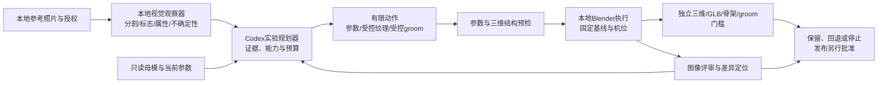

# 喵星视觉驱动建模：可落地方案与首个实验

目标是让视觉观察和实际三维反馈决定下一步修改：**照片证据 → 可解释差异 → 可执行的有限动作 → 实渲染 → 再观察 → 保留/回退/停止**。Blender 是执行器，视觉模型是观察/评审组件，Codex 是受约束的实验规划器，结构验证器有独立否决权。当前生产 `infer` 仍不可用；本文与新增校准 POC 不声称已实现猫照片理解、个体识别或生产推理。

本方案复用现有 CLI、Skill、v3/v4/v5 迁移、asset/topology/groom/renderer 契约与本地结果回传；不重写造型室，不新增未经支持的 v5 参数，不更新 current 或账号记录。研究细节和配对数据规范见 [CAT-VISION-DATA-AND-EVALUATION.md](CAT-VISION-DATA-AND-EVALUATION.md)。

## 1. 系统如何分工



“本地 Agent”不等于“本地视觉推理”：如果把照片交给云端 Codex 或远端模型，图像仍然外传。默认用本机视觉模型或人工标注，只输出本地结果；云端规划器需要数据时，先明确准许的元数据/截图范围。未经批准不向云端发送原图、裁切、渲染、embedding 或日志中的图片内容，也不自动下载模型。

采用外部服务前必须列出服务商/端点、传输内容（原图/裁切/渲染/特征）、用途、留存/训练条款、授权范围与撤回方式，并取得明确批准。无可用且获准的视觉适配器时报告 unavailable，不能回退到偷偷上传或随机“预测”。

## 2. 照片理解要输出什么

输出是实验的观察记录，不向现有严格 request 任意追加字段。每条特征记录本地图片 SHA、裁切/坐标变换、证据区域、测量方法、可见性、区间/不确定性、来源（测量/模型假设/用户确认）和相关视图。没有照片时值保持 unknown；不把品种先验写成个体事实。

| 信息 | 首轮可行方法 | 必须保留的不确定性 |
| --- | --- | --- |
| 脸型、眼鼻耳标志 | 人工校正的局部标志 + 分割；通用 VLM 提议，专用检测器后续替换 | 毛/眼睑/焦距/俯仰会改变外轮廓；单正面不能确定头深 |
| 头身比、腿尾轮廓 | 完整站立多视图、独立头/躯干遮罩和尺度比 | 缺尺度物时不能得到真实米制尺寸；现有 v5 不支持身体比例编辑 |
| 毛色花纹 | 遮罩内色块、边界、可见左右差异，记录白平衡 | 阴影不等于 albedo，背腹不可见部分 unknown |
| 毛长与毛流 | 可见毛束/轮廓方向，灰模与被毛分别观察 | 不可从照片直接得到真实毛囊密度、内层曲线或皮肤表面 |

不使用 VLM 自报“0.9”作为校准概率。用可见性、重复标注差异、视角变化和独立验证集建立可靠性；保留 measured interval 或 low/medium/high 且标明未校准。遮挡特征权重为零，不能靠填默认点制造精度。真实记忆字段不用于模型训练或外观打分。

单条结构化观察可采用下列实验记录形态（当前没有真实照片，数值留空；不是新增生产契约）：

```json
{
  "localImageId": "photo-front-01",
  "imageSha256": null,
  "viewCalibration": "unresolved",
  "feature": "face-width-to-height",
  "value": null,
  "interval": null,
  "visibleRegion": null,
  "method": "unavailable",
  "confidenceCalibration": "unverified",
  "alternatives": ["head geometry", "cheek fur", "camera perspective"],
  "actionability": "needs-aligned-observation"
}
```

一条评审问题则链接这些观察、候选渲染/视图 SHA、受影响部位、可证伪假设、允许的参数及Δ、预期改善与失败门槛；只有实际能力和敏感性支持后才转成现有 local-edit request。

## 3. 视觉评审怎样变成动作

先校准姿态/镜头，再固定相机、归一化、灯光、曝光和随机性。评价同时查看参考、正常材质渲染、灰模/轮廓/ID等诊断通道；定位“几何过宽”“颊毛撑大”“高光遮住眼裂”等不同问题，并记录替代解释。颜色、毛发和几何分轮处理，禁止一起乱调后把收益归给某个参数。

首个动作只用已存在的 `headWidth`。在真实母模上先渲染 θ、θ−3、θ+3，测量目标区域是否响应、其他区域是否退化。用图像特征的有限差分估计局部敏感度；若变化小于标注/渲染噪声或与其他控制不可区分，就锁定该参数，不猜测方向。

后续多个参数可解一个受信赖域约束的小问题：最小化“有证据的特征残差 + 改变量惩罚”，限制每项 Δ 和总轮数。Codex 的职责是挑选有证据且可操作的假设、解释冲突与决定停下；数值工具负责可重现测量。不能让自由文本直接运行 Python 或修改任意 mesh。

| 视觉差异 | 当前可执行映射 | 明确不支持/后续范围 |
| --- | --- | --- |
| 脸宽/深、颊/颌、口鼻、眼区、耳大小/外张 | 14 个既有脸部控制；`Head_round/wedge=v/100`，其余 low/high 以50为中性 | 不生成不存在的耳根位置、单耳、瞳孔或身体参数 |
| 区域毛量/毛长 | web groom 下 head/ruff/body 共6项，使用原profile，不改变所有猫共用profile | 当前 Blender 对照脚本跳过这6项，不会改原生groom；因此毛发拟合不属于首轮已执行能力 |
| 毛色/花纹 | 后续B模块在已知UV上输出局部纹理候选，旧纹理保留；先局部人工校正 | 不是现有creator v5参数，旧 `CatDesign` 的色彩控件不能冒充兼容 |
| 毛向/分缕 | 后续C模块在固定根/三角形/重心绑定上调整导引方向/长度，明确表示 | 当前无每区域方向滑块；不能靠修改全局源码或重新长一层毛绕过 |
| 身体、头身比、腿尾长度 | 先记录结构化观察及 unsupported | 需要另行美术交付可验证的参数化形态/骨架适配，不能偷偷改变现有20参数语义 |

任何候选只写新的隔离任务。Morph-only 修改必须保持基础拓扑、UV、绑定、骨架和原贴图摘要；不能每轮重新生成猫。导出的 assetRevision 可变，旧资产 ID/current 不变。真实接入继续使用既有 inspect/validate/preview 和 local-task/local-result；没有权重时不调用生产 infer 冒充结果。

## 4. 首个真实照片实验：MacBook 一猫一参数

目的不是训练或完整重建，而是回答：“同一母模一个真实 Shape Key 的有限修改，是否在固定条件下更接近这只猫，并且没有破坏三维结构？”允许结论为无改善或不可辨识。

1. **选取资料。** 一份获准审查的现有 Norwegian 或 Sphynx 作者副本及对应 GLB/manifest、完整当前 appearance。参考为同一只猫的清晰正面、侧面/斜面，另保留独立视图/拍摄 session 作最后验收。不能用有毛照片去验证无毛皮肤的全部视觉相似度。
2. **固定基线。** 记录源 SHA、实际26/53 targets、bodySurface、pose=stand、blink=0、材料/毛发和工具版本。先匹配镜头，再保存基线 framing/相机矩阵、归一化与灯光，后续不得重新按候选包围盒自动缩放。
3. **观察。** 本地视觉适配器/人工标注得到脸部外轮廓和可靠标志；Codex 根据获准的观察或图像指出头部应更宽/更窄/unknown，区分颊毛和镜头解释。若方向不清楚，停止修改。
4. **修改。** 只改变 headWidth，不动其余19项、coatType/coatMode、贴图、groom、pose或相机。先测 ±3 方向响应，最多3轮小步。参数范围和实际能力通过现有校验；重开原只读源，每次在新任务中设置真实 low/high 权重，不累积破坏性编辑。
5. **再观察。** 保存实际 PNG、参数diff、morph权重/顶点位移和摘要。比较拟合视图及开发验证视图，接受必须超过噪声且无不可接受的其他区域回归；失败回到上一已知基线。
6. **结束。** 最后只看一次独立保留视图，请主人盲比较熟悉感。导出新GLB并回读，再做骨架/眼睑/groom/房间兼容检查。没有这些检查不能成为发布候选；不更新账号或 current。

会反复参与候选接受/回退的“保留视图”实际是**开发验证视图**。真正最终视图不得用于步长/参数选择；用它继续调参后就需要新的最终数据。当前小校准 POC 的第二视图只是开发验证，不声称独立泛化测试。

### 现有代码需要注意的实际缺口

- `lib/cat-visual-validation.ts` 和 Blender 对照脚本按每次设计后的全身 bounds 归一化，可能掩盖形态变化。真实实验前，本地执行器必须提供“锁定基线 framing”能力及日志。若只用当前脚本，只有实测 baseline/candidate framing 完全一致时才可比较；不一致则阻塞，不能用分数解释掉。
- Blender 脚本目前不复现网页可选 `Combo_*` / `Blink_*` 权重逻辑，且跳过6项毛参。当前manifest无Combo且blink0时基础映射可用；其他控制组合/闭眼/被毛实验必须先补齐共享权重映射或明确unsupported。不能把它称为完整双端同渲染。
- export 是当前静态 groom 快照且移除动画。骨骼克隆不等于几何/材质深拷贝；只能进行隔离权重修改，破坏性修改须重载源或深拷贝数据。后续编辑/动作不应在静态烘焙毛上自动再长毛。

## 5. 接受与停止的门槛

保留一个候选需要分别满足以下条件；分数不能抵消结构失败：

- **个体/二维**：只在可靠且对齐的区域比较，报告脸型/标志/花纹的逐项变化和区间；CLIP/DINO或VLM意见只是弱证据，主人熟悉感单独记录。
- **解剖/三维**：真实morph缓冲有效、坐标有限、无新增退化/翻面/异常拉伸，眼球/眼睑与耳口关系合理；缺视图或不可见部位继续unknown。
- **稳定性**：允许参数及步长内、基础拓扑/UV/skin/骨架/原图不变、同输入可复现、原件SHA不变；对实际参数组合验证，不只看JSON合法。
- **动作/groom/接入**：Blink、站/趴与所需动作、皮肤毛根关系、静态/动态表示、GLB回读、旧appearanceAsset/旧外观恢复通过。若尚未运行，标unrun并禁止生产放行。

开始前约定轮数/渲染次数/耗时/内存预算。达到预算、两个候选均无超过噪声的收益、连续振荡、跨视图冲突、证据不足/能力不支持、任何结构失败即停止并保留最好已知基线。小步长/噪声阈值是实验初值，须据母模敏感度和标注重复性校准，不是全猫品类通用美术标准。

上述结构失败即暂停适用于首个真实猫实验，由本地 Agent 诊断后才另开实验。几何校准 POC 使用更有限的候选规则：一个隔离候选的结构失败会否决该候选，可以继续考察另一候选；整轮无候选通过才停止。源/基模改变、渲染进程失败或图像身份异常则整个 POC 失败。不能把这个较小范围的控制器当作真实母模的完整安全门槛。

## 6. 现成模型与专用训练边界

可先采用本地人工标注、通用提示分割、通用VLM差异描述、DINO/CLIP类辅助表征；具体checkpoint、MLX/Metal/CUDA适配、权重许可和内存开销必须先核查，当前不下载、不调用。通用描述可以发现“耳朵太外张”，不能证明对应某个滑块数值或个体识别准确率。

真正猫专用能力需要合法配对数据：同个体多视图照片/姿态/光照、分割与关键点及标注分歧、已知母模/UV/骨架/全参数、同机位多参数实渲染、结构失败标签、主人/美术盲评和局部修改前后结果。人工拟合的模板参数不是猫的真实解剖真值，要记录可辨识范围与不确定性。按猫个体、原始母模来源、拍摄session划分数据，不能把同图裁切或相邻渲染拆进测试集。

A先学可辨识的模板形态参数；B学UV上无固定阴影的毛色花纹与置信mask；C学有真实表面锚定、方向/长度/层次监督的groom。先证明现有控制和视觉信号确实有效，再判断是否值得收集/训练；若误差来自母模能力缺失，训练大模型不能替代美术/拓扑交付。训练、参考使用和公共分发权限分别确认。

## 7. 最小概念验证与所需本地能力

新增 `cat-modeling/vision-poc/` 的校准实验只验证真实渲染反馈如何控制一个真实编辑参数：同一个原创几何样本、实际 headWidth Shape Key、固定机位、图像观察、有限候选、结构门槛及再观察。目标图是明确的合成参考，不是真实宠物照片；局部遮罩分析不是猫专用视觉模型。其运行结果不能背书私有猫、骨架、毛发、身份或生产接入，真实照片实验仍需要上面的Mac资料。

MacBook 本地 Agent 需提供：

| 输入/能力 | 最小要求 |
| --- | --- |
| 母模 | 一份获准只读`.blend`与对应GLB、manifest、完整appearance；实际 headWidth low/high、骨架/眼部/UV/groom信息；源及依赖摘要，不必公开上传 |
| 参考 | 同一猫2–3张可对齐的正/侧/斜图，另留最终验收视图；图像使用同意/摄影版权；标志或遮罩可先人工校正，EXIF敏感信息不回传 |
| 渲染基线 | 正/侧/斜正常显示和必要灰模/遮罩，固定矩阵/曝光/光照/pose、基线framing与全部参数；参数敏感性±3的真实渲染 |
| 执行 | 对应Blender准确版本、固定操作allowlist、新目录/原件保护、参数权重应用、基线锁定、PNG和GLB导出回读、失败/退出码/资源日志 |
| 视觉 | 本地可用模型/checkpoint/许可/推理后端及芯片/内存预算，或先用人工标点；未配置时不能宣称自动照片理解。无需提供机器序列号或任何密钥 |
| 回传 | 默认参数、观察/不确定性、图像/源/产物摘要、结构报告和决定记录；照片/截图仅在明确批准传输范围后提供，不提交公共仓库 |

第一轮成功是一次可追溯、可以失败且可回退的真实实验；不是新增一组接口，也不是承诺一定更像。后续才在有证据的模块上增加专用视觉模型和训练。

## 8. 本轮实际执行的最小闭环

运行命令（下面是实际已执行目录，重跑须换新目录）：

```sh
npm run vision:poc -- --demo --blender /usr/bin/blender \
  --out /workspace/CatPlanet/cat-modeling/jobs/vision-poc-demo-20261108-verified
```

Blender 4.3.2 / Cycles CPU / 256×256 / 8 samples。仅初始化一次原创样本和 headWidth 真实非零 Shape Key，之后重载同一只读 `.blend`。控制器读取实际 PNG 的头部 ID mask、全体轮廓和归一化头宽；不接收参考生成器的参数。相机、材料、站姿、基线归一化与源文件不变。

| 实测结果 | 基线50 | 两轮保留后56 |
| --- | ---: | ---: |
| 前视头部mask IoU | 0.893084 | 0.945619 |
| 前视诊断loss | 0.159547 | 0.085960 |
| 开发验证视角头部mask IoU | 0.922555 | 0.947003 |
| 开发验证视角诊断loss | 0.108373 | 0.073615 |

第一轮实际试47/53后保留53，第二轮试50/56后保留56。第三轮试53/59，59仅让开发验证视角继续改善，前视像素目标与56相同；因未满足预设的前视严格改进门槛而停止，**没有达到参考目标**。这暴露了256px离散mask和单主目标的局限，不能事后放宽规则来假报收敛；下次实验应先登记噪声尺度或多视图接受规则。

每个被接受候选均核对实际读取的 Blender ShapeKey 权重、参数步长、源/base SHA、拓扑/UV摘要、配置、有限坐标、三角形退化与方向。测试会拒绝“请求只改3点但实际权重改很大”的候选，不能只信任务标签。独立复核重读16张PNG并重算指标与决定，未发现差异；worker SHA 与当前代码一致。

报告和对照图位于被忽略的 `cat-modeling/jobs/vision-poc-demo-20261108-verified/{report.json,comparison.png}`。源GLB与base前后SHA一致。13项新控制器测试通过，原81项工程测试继续通过，类型检查通过。公开测试不运行 Blender；上述渲染是单独实际执行记录。

它证明了“图像观察改变下一次参数、真实执行后重新测量并可以停止”，不是猫照片理解：红色ID/透明背景只适用于受控样本；拓扑/UV稳定只证明本样本，UV为空也如实报告。真实身份、物理材质、rig、groom、照片理解和生产兼容全部 `UNRUN`，`approved:false`、`productionReady:false`。对照图不应当作喵星猫咪外观成果展示。
